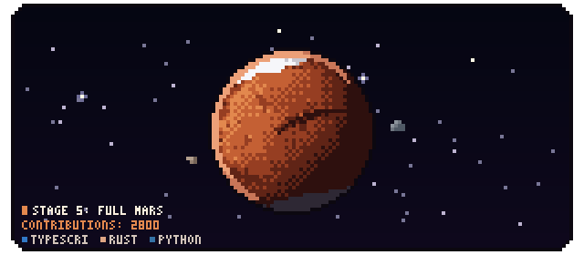
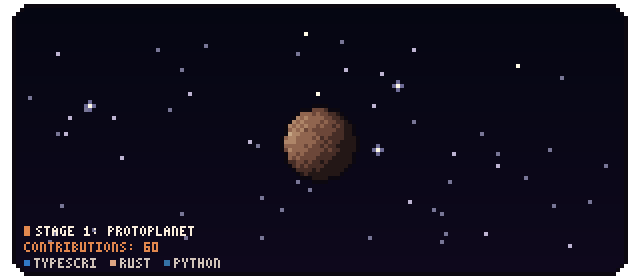
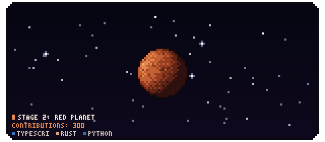
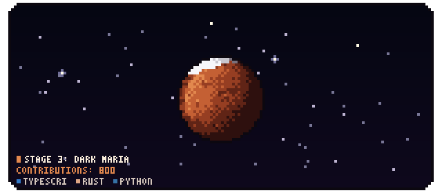
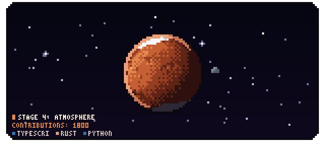
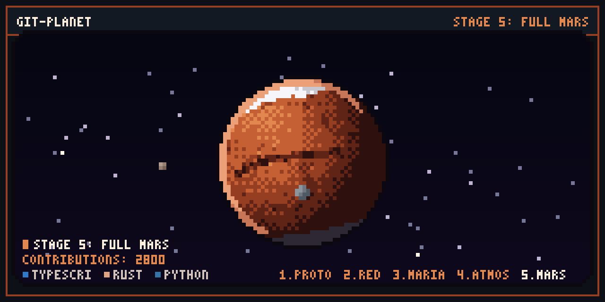

# git-planet

A pixel-art **Mars-like planet** for your GitHub profile. Every January 1st it starts again as a small gray protoplanet. As your contributions add up it turns red and gains dark maria, polar ice caps, a dusty atmosphere, the Valles Marineris canyon, the Olympus Mons volcano and the moons Phobos and Deimos, all while spinning in a seamless loop.

<p align="center">
  
</p>

## Setup

Replace `<your-username>` with your GitHub username. The examples assume this project is published at `github.com/<your-username>/git-planet`.

**1.** In your profile repository (`<your-username>/<your-username>`), create `.github/workflows/planet.yml`:

```yaml
name: Update planet

on:
  schedule: [{ cron: "0 0 * * *" }] # every day at midnight UTC
  workflow_dispatch:

permissions:
  contents: write

jobs:
  planet:
    runs-on: ubuntu-latest
    timeout-minutes: 10
    steps:
      - uses: <your-username>/git-planet@v1
        with:
          window: annual # or `rolling` for the trailing 365 days
```

**2.** Add the image to your profile `README.md`:

```markdown
<p align="center">
  /<your-username>/output/planet/planet.gif" width="640" alt="My planet" />
</p>
```

**3.** Run the workflow once from the **Actions** tab. After that it updates daily.

## Stages

Growth follows `g = (contributions / 2800)^0.45`, so early contributions count the most.

| Stage | Contributions | Preview | What forms |
| :--- | :---: | :---: | :--- |
| 1. Protoplanet | `0 – 149` |  | A small gray, cratered rock. |
| 2. Red Planet | `150 – 499` |  | The surface rusts orange-red and the planet grows. |
| 3. Dark Maria | `500 – 1,199` |  | Dark regions and the north polar ice cap. |
| 4. Atmosphere | `1,200 – 2,499` |  | South ice cap, dusty haze on the sunlit edge, and Phobos. |
| 5. Full Mars | `2,500+` |  | Valles Marineris, Olympus Mons, and Deimos. |

Each run also writes a `1280×640` **share card** (`planet/share-card.png`):

<p align="center">
  
</p>

## Action inputs

| Input | Default | Description |
| :--- | :--- | :--- |
| `login` | repository owner | GitHub account whose planet to draw. |
| `window` | `annual` | `annual` (resets every January 1st) or `rolling` (trailing 365 days). |
| `canon` | `"false"` | `"true"` keeps the moons plain gray instead of tinting them with your top languages. |
| `output-dir` | `planet` | Folder for `planet.gif`, `planet.png` and `share-card.png`. |
| `commit` | `"true"` | Publish the images to `branch`. |
| `branch` | `output` | Branch that receives the images, force-pushed as one commit so history never grows. |
| `token` | `${{ github.token }}` | Token used to read your contributions and push the images. |

## Command line

```bash
cargo install --path .

# Fetch your data (needs a token: GitHub Actions provides one automatically)
export GITHUB_TOKEN=$(gh auth token)
git-planet collect <your-username> --window annual --output snapshot.json

# Draw planet.gif, planet.png and share-card.png
git-planet render snapshot.json --output-dir planet

# Preview any contribution count offline
git-planet demo --commits 800 --output-dir preview
```

## How it works

```
GitHub GraphQL ──► github.rs ──► AccountSnapshot ──► render.rs ──► encode.rs ──► planet.gif / .png
                   (collect)     (snapshot.rs)        ▲      ▲
                                                 planet.rs  hud.rs
                                                 palette.rs
```

| Module | Responsibility |
| :--- | :--- |
| `github.rs` | One GraphQL request for the contribution total in the window and your repositories' primary languages. Validates the login, uses connect/read/overall timeouts, and retries network errors, `429` and `5xx` with exponential backoff and jitter, so it never hangs. |
| `snapshot.rs` | The data the renderer uses (`AccountSnapshot`), the `annual`/`rolling` window ranges, and an offline `demo` snapshot. |
| `planet.rs` | Turns the contribution count into a stage and smoothly fading features, describes the terrain at any point of the sphere with 3D fractal noise seeded by your account ID, and defines the moon orbits. |
| `render.rs` | Draws each frame at half resolution (`160×70`): a starfield panel, the lit and dithered planet spinning one full turn per 48-frame loop, and the moons passing in front of and behind it. The result is upscaled 2× before the HUD is added. |
| `hud.rs` | The pixel-font stage, contribution count and language labels, plus the share card. |
| `palette.rs` | Martian colors. Your top two languages tint Phobos and Deimos. |
| `encode.rs` | PNG and looping GIF output with nearest-neighbor upscaling. Each GIF frame stores only its drawn area and its own palette. |
| `error.rs` | One error type for the whole crate, with clear messages. |

## Development

```bash
cargo fmt --all -- --check
cargo clippy --all-targets -- -D warnings
cargo test
```

Pushing a `vX.Y.Z` tag builds release binaries for Linux, macOS and Windows (`.github/workflows/release.yml`), which the action downloads instead of compiling.

## License

MIT. See [LICENSE](LICENSE).
